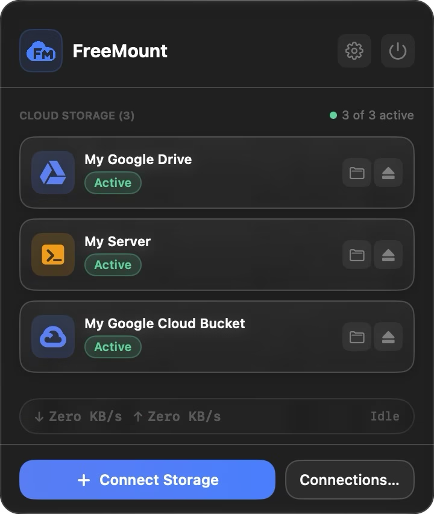
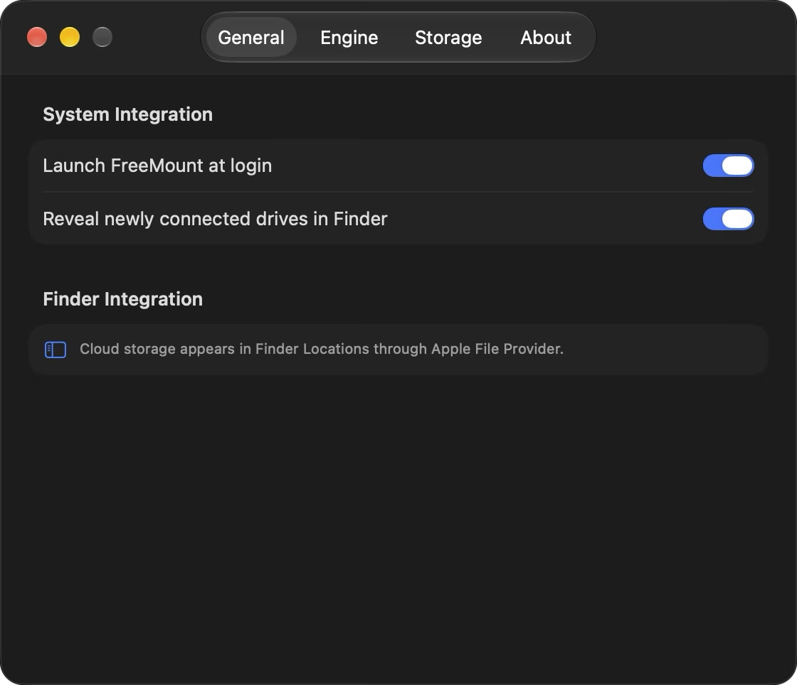
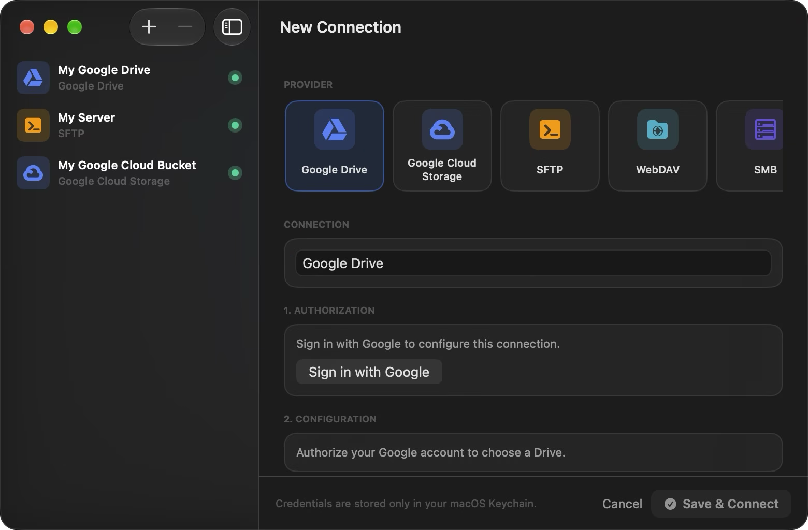
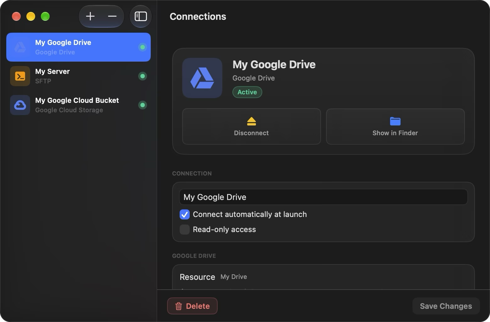

# FreeMount

FreeMount is an open-source macOS app that shows cloud storage in Finder. It is built with SwiftUI, Apple's File Provider framework and [`rclone`](https://rclone.org). It needs no FUSE-T, macFUSE or NFS mounts.

## Screenshots

| Menu Bar | Settings |
| :---: | :---: |
|  |  |
| **New Connection** | **Connection Manager** |
|  |  |

## Why FreeMount

I wanted my servers and buckets in Finder like normal disks. Many of my servers have no open ports, so I need to reach them through tunnels. I built FreeMount so SFTP works that way. CloudMounter inspired the idea.

FreeMount connects SFTP through the access path you already trust:

- **Cloudflare Tunnel** (`cloudflared access ssh`), so no inbound port is open
- **Jump host / bastion** (`ProxyJump`)
- **Custom `ProxyCommand`** for anything else (SOCKS proxy, `ncat`, ...)

It is also open source and free, and uses Apple's native File Provider rather than a third-party filesystem extension. Files appear in Finder under Locations, are downloaded on demand and are managed by macOS.

## Supported storage

| Provider | Status |
|---|---|
| Google Drive | Working |
| Google Cloud Storage | OAuth and Service Account keys, one bucket per connection. Live validation pending. |
| SFTP, WebDAV | Working. SFTP supports Cloudflare Tunnel, jump hosts and custom ProxyCommand. WebDAV Digest-only servers are unsupported. |
| SMB, FTP/FTPS | Implemented. Live validation on real servers pending. |
| S3 | Planned |

Connections appear in Finder under Locations (`~/Library/CloudStorage`). Credentials stay in the macOS Keychain; nothing sensitive is written to disk in plaintext.

## How it works

```text
FreeMount menu bar app
    ├── Keychain: cloud credentials
    ├── rclone rcd: remote file operations and telemetry
    └── File Provider domain registration
             └── FreeMountFileProvider.appex
                      └── Finder Locations / CloudStorage
```

The app starts an authenticated local `rclone rcd`, then registers File Provider domains. The extension reads a non-secret descriptor from the shared App Group, loads credentials from the shared Keychain access group and calls the local RC API. macOS manages downloaded copies.

## Build

Requires macOS 14+, Xcode and XcodeGen. A free Apple ID is enough to build and run it
locally. For a hands-off install use [`scripts/install-from-source.sh`](docs/install-from-source.md):

```bash
./scripts/install-from-source.sh
```

Manual path:

```bash
cp Configs/Secrets.xcconfig.example Configs/Secrets.xcconfig   # set your Team ID (OAuth defaults are bundled)
xcodegen generate
xcodebuild -project FreeMount.xcodeproj -scheme FreeMount -configuration Debug -allowProvisioningUpdates build
swift test
```

Details: [docs/building.md](docs/building.md).

## Distribution

There are no public downloads yet, and there will not be until the app can be
signed with an Apple Developer ID and notarized. The app relies on App Groups,
shared Keychain access groups and a sandboxed File Provider extension —
entitlements that require a signing identity, so ad-hoc or unsigned builds do
not launch on other Macs. Building from source with your own free Apple ID is
the supported way to run it today — see
[docs/install-from-source.md](docs/install-from-source.md).

## Documentation

See [docs/](docs/README.md): [architecture](docs/architecture.md), [security](docs/security.md), [adding a provider](docs/adding-a-provider.md).

## Limitations

GCS uses standard rclone operations with best-effort metadata checks. It does not protect against concurrent external writers, and hydration is not pinned to an object revision.

## License

[MIT](LICENSE). Bundled rclone is also MIT-licensed.
