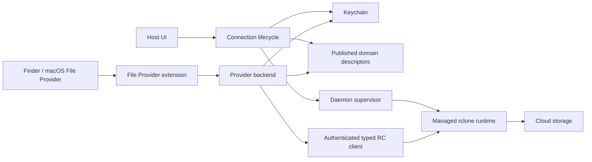

# FreeMount Architecture

Global engineering rules live in [`AGENTS.md`](../AGENTS.md).

## Product boundary

FreeMount is a small native macOS application that connects supported cloud
storage to Finder using Apple File Provider. Its essential user flow is:
connect an account or bucket, browse and edit files in Finder, see connection
health, and disconnect safely.

Use SwiftUI/Observation for the host, Apple's File Provider for filesystem
presentation and local materialization, Keychain for secrets, and authenticated
loopback rclone RC for file operations. No alternative mount engine, independent
sync engine, application-managed VFS cache, or generic provider framework is
needed for this flow.

Google Drive and GCS have implementations. GCS live Finder sign-off remains
pending. SFTP, WebDAV, SMB and FTP/FTPS use registered adapters over the shared rclone backend.
SMB live Finder sign-off remains pending. S3 is unavailable until its backend and
end-to-end validation exist. Existing Drive account deduplication and GCS bucket
connection identity must be preserved; do not invent a new identity scheme during
cleanup.

## Components and ownership

| Component | Responsibility | Must not own |
|---|---|---|
| Host app (`App/App`, `App/Views`, `App/ViewModels`) | Connection forms, lifecycle coordination, health and user-facing errors | Cloud file mutation execution or a second sync/retry engine |
| Connection services (`App/Services`) | Secure credentials, persistent connection settings, domain registration and one daemon lifecycle | UI layout or provider-specific object semantics |
| Shared File Provider code (`App/FileProvider`) | Published connection descriptors, current-policy resolution, item/error mapping and narrowly shared operation helpers | A second authoritative connection database |
| File Provider extension (`App/FileProviderExtension`) | Translate Apple's enumeration, hydration and mutation callbacks into backend operations | Independent daemon ownership or speculative cloud recovery workflows |
| Provider adapters (`App/Providers`) | Authentication/discovery, naming, capabilities, object versions and provider-specific behavior | Host presentation, unrelated provider behavior or duplicate transports |
| RC client (`App/Core/RcloneClient.swift`) | Typed asynchronous requests, authenticated jobs, cancellation and transport errors | Connection UI or business policy |
| Managed rclone runtime (runtime scripts) | Execute ordinary RC operations with pinned official binaries | Credential persistence or user-facing state |

These are responsibility boundaries, not a requirement to create a class,
protocol, actor or service for every row. Keep useful small helpers. Consolidate
wrappers that only forward calls without enforcing a boundary or invariant.

Provider discovery and OAuth may call their official HTTPS APIs directly. These
control-plane calls do not introduce a second file mutation transport.

## State and persistence

- **Connection settings:** the host owns saved non-secret connection configuration.
- **Credentials:** Keychain owns tokens, passwords, keys and local RC credentials.
  Descriptors, logs and journals contain references or redacted metadata only.
- **Extension catalog:** one canonical App Group descriptor file publishes the
  host's connection configuration to the extension. It is a derived projection,
  not a competing database. Valid empty content means no connections. Publication
  must be atomic; failure must reach the host. Legacy stores are migration inputs,
  not indefinite parallel read/write fallbacks.
- **Registration and health:** macOS owns registered domains; the host observes
  registration and remote health separately. A failed registration cannot become
  a successful mounted state. Network failure does not erase connection settings
  or credentials and need not unregister cached domains.
- **File content and offline copies:** macOS File Provider owns local storage.
- **Finder location:** only macOS's domain root URL is authoritative. Connection
  configuration no longer stores `localMountPoint`; old JSON keys are ignored while
  IDs and credential references survive. Connected runtime state may have no path
  until macOS supplies one. Show in Finder resolves the current URL on each request,
  including after rename, and reports unavailable locations without changing
  registration. Retaining predicted paths or adding a persisted Finder path would
  reintroduce stale parallel state, so neither is used.
- **Operation recovery:** persist only the identity and progress necessary for an
  explicitly supported operation. History is diagnostic and never authoritative
  mutation intent. Existing ambiguous journals and retained staging require safe
  reconciliation before deletion or migration.

Stable domain/item identifiers and stored credential references are compatibility
boundaries. Simplification must not silently recreate domains, discard offline
edits, reset settings or delete credentials.

## Core flows

### Connect and reconnect

1. Authorize using the provider's supported flow; put secrets in Keychain.
2. Validate the selected resource and save non-secret configuration, reusing an
   existing matching connection where appropriate.
3. Publish its descriptor; ensure the authenticated daemon is ready before
   registering or signaling the File Provider domain.
4. Record registration success separately from a provider health probe. Discard
   stale asynchronous results after connection replacement or removal.

The host coordinates bounded daemon recovery. The extension may wait/retry for
transport readiness, but must not launch a competing daemon. Reconnection policy
must match the UI; a saved toggle with no runtime effect is not acceptable.

### Browse, download and edit

1. Finder requests work through the extension.
2. The extension resolves the current descriptor and access policy and invokes
   the provider backend through one version-aware public operation contract.
3. The backend validates names, capabilities and expected versions and uses the
   shared RC client. Low-level path primitives remain implementation details.
4. Return confirmed metadata/results or a meaningful mapped error to macOS.
   Activity observes daemon transfer telemetry; it does not instrument these
   callbacks or replay cloud mutations.

Enumeration publishes only complete successful inventories. Listing failures or
resource limits must not appear as successful empty inventories. Share complete
tree-reading mechanics where useful, while keeping operation-specific policies
explicit.

### Disconnect

Coordinate domain removal before retiring configuration and unreferenced
credentials. Report partial failure and preserve enough state to retry safely.
Keep one lifecycle action for all UI entry points; views own confirmation and
presentation, not separate removal implementations.

## Reliability boundaries worth keeping

- Preserve read-only policy, authentication, credential redaction and provider
  metadata preflight checks. These checks are best effort and are not atomic with
  a subsequent cloud operation.
- Distinguish confirmed success, confirmed failure and unknown remote outcome.
  Cancellation after confirmed commit must not turn success into failure.
- Use bounded asynchronous job handling; an unknown result does not justify blind
  replay or cleanup of possibly active staging.
- GCS copy/delete moves are non-atomic. Never claim transaction guarantees across
  objects. Require an absent destination before copy and a complete verified
  inventory before source cleanup; concurrent external writers remain outside
  the accepted guarantee.
- Retry only when original operation identity and outcome make it safe. Complex
  recovery is a product capability with maintenance cost, not an automatic addition
  to every bug fix.

## Accepted scope and limits

- **Runtime:** checksum-pinned official rclone, no custom patch. GCS uses ordinary
  RC operations with best-effort metadata preflight; there is no protection from
  concurrent external writers and hydration is not revision pinned.
- **GCS names:** listing omits unrepresentable or colliding object names. Unsafe
  folder mutations are rejected using complete inventories.
- **Daemon:** `FreeMountApp` creates one `RcloneProcessSupervisor` and injects it
  into lifecycle, forms, settings and telemetry. Shutdown is graceful for 1.5 s,
  then SIGKILL.
- **Activity:** in-memory session telemetry only (up to two hours / 1,000 results).
  No disk history, replay or cancellation path; Finder controls cancellation.
- **Live validation pending:** GCS, SMB, FTP/FTPS and WebDAV on real servers.

## Verification

Use `swift test` for shared logic. Extension changes also need a signed app and
extension build; SPM alone does not compile every extension path. Filesystem
changes need disposable-resource Finder checks (enumeration, hydration, writeback,
rename/move/delete, offline recovery, cancellation, conflicts as affected).

Update this document when component ownership, persistence authority or execution
flows change.
